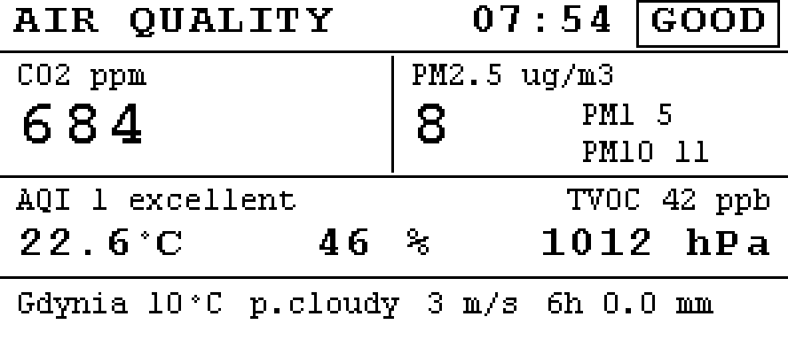
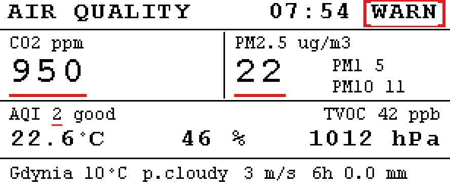
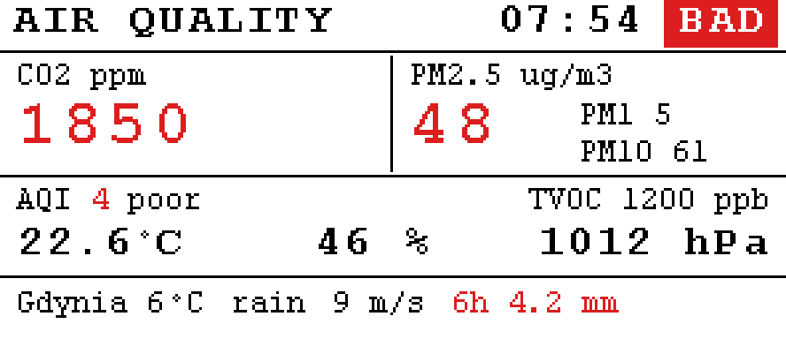
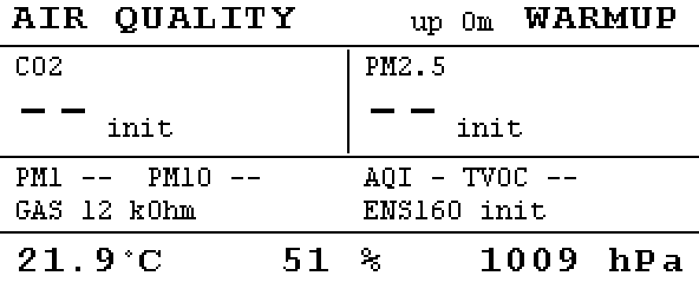

# IAQ-MK2

Standalone indoor air-quality station on an Arduino Nano RP2040 Connect with a
Waveshare 2.9" e-Paper Module (B) V4 status panel (SSD1680, 296 x 128,
black/white/red, full refresh ~14-16 s). Over WiFi it shows the time and the
Gdynia forecast from MET Norway (the data behind yr.no).

Verified on the bench on 2026-10-07: all four sensors deliver data and the panel
refreshes. The panel was originally assumed to be the four-colour 2.9" (G); the
bring-up log (see "Design notes") shows how it was identified as the (B) V4.

| Sensor | Measures | Interface |
| --- | --- | --- |
| DFRobot SEN0219 (PWM revision) | CO2, real NDIR, 400-5000 ppm | PWM on D2 |
| Plantower PMS7003 | PM1.0 / PM2.5 / PM10 | UART (Serial1) |
| ScioSense ENS160 | AQI (1-5), TVOC, eCO2 (logged only) | I2C 0x53 |
| Bosch BME680 | temperature, humidity, pressure, gas resistance | I2C 0x76/0x77 |

The panel is a snapshot: sensors are sampled continuously, the display is
refreshed every 3 minutes (the Waveshare minimum) and put to deep sleep in
between. Colour is used only for status: black = good, red marks (underline,
outlined badge) = warn, red = bad. The bottom line is the outdoor forecast
(temperature, sky, wind, rain in the next 6 h in red from 0.5 mm); the header
shows the time of the last refresh.






CO2 on the panel always comes from the NDIR sensor. The ENS160 eCO2 estimate is
only written to the serial log.

## Wiring

| Device | Pin | Nano RP2040 Connect |
| --- | --- | --- |
| e-paper | VCC | 3V3 |
| e-paper | GND | GND |
| e-paper | DIN | D11 (MOSI) |
| e-paper | CLK | D13 (SCK) |
| e-paper | CS | D10 |
| e-paper | DC | D9 |
| e-paper | RST | D8 |
| e-paper | BUSY | D7 |
| BME680, ENS160 | SDA / SCL | A4 / A5 (board has 4.7 k pull-ups) |
| BME680, ENS160 | VCC / GND | 3V3 / GND |
| PMS7003 | VCC / GND | 5 V / GND |
| PMS7003 | TX | D0 (Serial1 RX) |
| PMS7003 | RX | D1 (Serial1 TX), optional |
| SEN0219 | VCC / GND | 5 V / GND |
| SEN0219 | PWM signal | D2 |

Check these before powering up a new build; each one silently breaks the
station if wrong:

1. **5 V rail.** The Nano RP2040 Connect ships with the `VUSB` jumper (SJ1 on
   the underside) open, so the "5V"/VUSB pin supplies nothing. Either solder SJ1
   or power the PMS7003 and SEN0219 from an external 5 V supply with a common
   ground. The 3V3 pin cannot run them.
2. **Panel model.** The vendored driver is for the 2.9" (B) V4 (SSD1680). The
   V3 of the same module uses a different controller (UC8151) and the
   four-colour (G) another one again; neither answers this driver. The label on
   the back of the panel says which one you have. Newer Waveshare modules add a
   ninth wire, PWR; this module has eight and needs none.
3. **SEN0219 revision.** DFRobot sold two sensors under this SKU: an older
   analog one (0.4-2 V output) and the current PWM one. This firmware expects
   PWM. Measure the signal pin with the sensor powered: a 3.3 V square wave with
   a ~1 s period is PWM. A slowly varying DC level is the analog revision,
   which needs the ADC (A0-A3) instead.

Logic levels: the RP2040 is 3.3 V only. The PMS7003 and SEN0219 are 5 V powered
but use 3.3 V logic on their data pins, so no level shifting is needed. The
e-paper module is 3.3 V. D13 is also the built-in LED, so it flickers during
SPI transfers.

## WiFi, time and forecast

Copy `iaq-mk2/secrets.example.h` to `iaq-mk2/secrets.h` (git-ignored) and put
your SSID and password in it. The station then:

- connects with a short per-attempt timeout and retries with backoff (10 s to
  10 min); nothing else waits for the network;
- takes the time from the NINA module's NTP client and shows it as
  Europe/Warsaw wall clock (CET/CEST rule computed on the board);
- fetches the MET Norway Locationforecast for Gdynia Wielki Kack
  (54.468 N, 18.495 E) once an hour over HTTPS, in a worker thread so the
  TLS handshake never stalls the loop or the watchdog. Point, cadence and
  User-Agent are in `config.h`.

**The NINA WiFi module needs firmware 3.0.1 or newer.** Older firmware (the
module shipped with 1.4.8) lacks the HARICA root certificate that api.met.no
uses, and the TLS connect fails within a second (`[wx] fetch failed (tls
connect)`). Update it with Arduino's firmware uploader, which also installs
the current certificate bundle:

```sh
arduino-fwuploader firmware flash -b arduino:mbed_nano:nanorp2040connect -a /dev/ttyACM0
```

or from the Arduino IDE: Tools, Firmware Updater. Re-upload the station
firmware afterwards (the updater leaves a passthrough sketch on the board).
The firmware version is logged at boot as `[net] x.y.z`.

Forecast data: MET Norway, CC BY 4.0 (https://api.met.no). The panel carries
no credit by choice; this README is the attribution.

## Build and upload

### arduino-cli (reproducible, pinned versions)

`iaq-mk2/sketch.yaml` pins the core and library versions. From the repo root:

```sh
arduino-cli compile --profile nanorp2040 iaq-mk2
arduino-cli upload  --profile nanorp2040 -p /dev/ttyACM0 iaq-mk2
arduino-cli monitor -p /dev/ttyACM0 -c baudrate=115200
```

Without the profile, install the core and libraries listed below and run
`arduino-cli compile --fqbn arduino:mbed_nano:nanorp2040connect iaq-mk2`.

### Arduino IDE

Board: *Arduino Mbed OS Nano Boards* -> *Arduino Nano RP2040 Connect*
(core `arduino:mbed_nano` 4.5.0). Library Manager:

- Adafruit BME680 Library 2.0.6 (pulls in Adafruit Unified Sensor, Adafruit BusIO)
- DFRobot_ENS160 1.0.1
- WiFiNINA 2.1.1 (pulls in Arduino_SpiNINA)

ArduinoJson 7.4.3 is vendored as a single header under `iaq-mk2/src/ArduinoJson/`.

Open `iaq-mk2/iaq-mk2.ino` and upload. The Waveshare display driver is vendored
in `iaq-mk2/src/waveshare/` (see its README for what was changed), so no
e-paper library is needed.

Uploads use the usual 1200-baud touch. Should a build ever leave the board
un-flashable, press RESET twice within half a second: the board enters the
bootloader and the next upload works.

Why these libraries: the `ScioSense_ENS160` v1 API is no longer published
under that name (it survives as "ENS160 - Adafruit Fork"), the official
`ScioSense_ENS16x` 2.x has a different API, and neither exposes the ENS160
validity flag that drives the warm-up indication. `DFRobot_ENS160` does and
was already proven on this hardware in IAQ-MK1.

## Host tests and previews

Pure logic (parsers, conversions, thresholds, formatting, the dashboard
renderer) builds and runs on the host with g++:

```sh
make -C tests          # unit tests
make -C tests preview  # renders dashboard PNGs into tests/out/ (needs uv)
```

The dashboard test renders extreme values into a framebuffer with a canary
behind it to catch out-of-bounds drawing, which the vendor Paint library does
not guard against, and checks that the two 1-bit planes sent to the panel
match the rendered pixels.

## Live readings

`tools/serial_dump.py` shows the station's summary lines as a table (events are
printed indented between rows), survives the board re-enumerating during an
upload, and can append the parsed readings to a CSV file. It needs only `uv`:

```sh
uv run tools/serial_dump.py                          # /dev/ttyACM0, until Ctrl-C
uv run tools/serial_dump.py --seconds 60 --csv readings.csv
uv run tools/serial_dump.py --raw                    # every line verbatim, timestamped
uv run tools/serial_dump.py --port /dev/ttyACM1
```

```
      t status   co2 co2_state  pm1 pm25 pm10 pm_state aqi  tvoc  eco2 ens_state  temp    rh  press    gas env_state
    200    BAD   404        ok    2    3    3       ok   3   268   771        ok  22.5  60.2 1003.9  702.3        ok
        [epd] refresh done, ms=16409
```

Its parser tests run with `make -C tests tools`.

## What the ENS160 AQI means

`aqi` is the ENS160's own 1-5 rating of its VOC signal on the German UBA scale,
computed inside the sensor; it does not use the NDIR CO2 or the PM values:

| AQI | ENS160 rating | UBA guidance |
| --- | --- | --- |
| 1 | Excellent | target value, no objections |
| 2 | Good | no relevant objections, sufficient ventilation recommended |
| 3 | Moderate | some objections, increased ventilation recommended, look for sources |
| 4 | Poor | major objections, intensified ventilation, look for sources |
| 5 | Unhealthy | not acceptable, use the room only if unavoidable |

Things to know when it reads 3 or higher while CO2 and PM are fine:

- The firmware maps AQI 1 to GOOD, 2 to WARN and 3 or more to BAD
  (`AQI_WARN`, `AQI_BAD` in `config.h`). Level 3 is "moderate", so a less
  alarming mapping is `AQI_WARN = 3`, `AQI_BAD = 4`.
- The rating is relative and baseline-driven. A MOX sensor adapts its baseline
  over the first day or two of continuous operation; readings right after
  flashing, reboots or moving the station are usually pessimistic.
- It reacts to all VOCs, not only people: solder flux and fresh electronics
  (a breadboard build qualifies), cleaning products, alcohol, perfume, food,
  new furniture, paint. `eco2` is estimated from the same VOC signal, so a
  high `eco2` next to a low NDIR `co2` means "VOCs from something other than
  breathing", which is exactly why the panel shows the NDIR value.
- Fresh-air test: put the station at an open window for ten minutes. `tvoc`
  should drop well below 100 ppb and `aqi` to 1 or 2. If it does, the room has
  a VOC source; if it does not, let the sensor run for a day and keep it away
  from the PMS7003 exhaust and the BME680 (its heater runs at 320 C).

## Serial log

115200 baud. One `key=value` line every 5 s (`LOG_INTERVAL_MS`), e.g.

```
t=312 status=GOOD co2=684 co2_state=ok co2_cycles=309 co2_rejected=1 pm1=5 pm25=8 pm10=11 pm_state=ok pm_frames=298 pm_crc_err=0 aqi=1 tvoc=42 eco2=612 ens_validity=0 ens_state=ok temp=22.6 rh=46.1 press=1012.3 gas=86.2 env_state=ok wifi=connected rssi=-66 time=08:33 wx_temp=9.8 wx_wind=2.9 wx_sym=p.cloudy wx_rain6h=0.0 wx_state=ok wx_ok=3 wx_fail=0
```

`wifi` is `connecting`, `connected`, `retry` or `no-module`; `wx_state` follows
the sensor states (`init` until the first good fetch, `stale` after 3 h without
one). Events: `[net] connecting`, `[net] connected <ip> rssi=<dBm>`,
`[net] time synced`, `[wx] fetching forecast`, `[wx] forecast ok, ms=`,
`[wx] fetch failed (<reason>)`.

Sensor states: `init` (nothing received yet), `warmup`, `ok`, `stale` (was ok,
no data within the timeout), `n/a` (not detected at boot). Events are tagged
`[boot]`, `[epd]`, `[warn]`, `[err]`. Serial output never blocks when no
terminal is attached. The first two seconds after boot are a grace period so a
terminal opened right after upload still catches the `[boot]` lines. A host that
keeps the port open but stops reading it makes USB writes block in the mbed
core; the watchdog then reboots the board every 8 s until the port is closed.

A healthy display refresh logs, in order: `init begin`, two BUSY transitions for
the hardware reset, `refresh started (full)`, `init ms=~1000`,
`busy-wait timeouts so far=0`, `panel busy after refresh cmd (good)`,
`BUSY pin -> HIGH`, and ~16 s later `BUSY pin -> LOW` and `refresh done, ms=~16400`.

## Configuration

Everything tunable is in `iaq-mk2/config.h`: pins, I2C addresses, intervals,
warm-up and stale timeouts, thresholds, display rotation (`90` or `270` if the
image is upside down), full/fast refresh ratio (the vendor fast mode is not
verified on this panel; the default is always a full refresh).

Thresholds: CO2 < 800 good, 800-1199 warn, >= 1200 bad. PM2.5 <= 15 good,
16-35 warn, > 35 bad. ENS160 AQI 1 good, 2 warn, >= 3 bad. Overall status is the
worst valid metric; `WARMUP` when nothing is valid yet.

## Bring-up checklist

1. Upload, open the serial monitor. Expect `[boot] BME680 found`,
   `[boot] ENS160 found`, `[boot] e-paper idle at rest`, then
   `[epd] refresh started (full)` and after about 16 s
   `[epd] refresh done, ms=...`. A `refresh TIMED OUT` line or `init ms`
   around 11000 means the panel did not answer: check the panel model, BUSY
   and the 3V3 supply.
2. The boot screen appears within ~20 s with `--` placeholders. If it is upside
   down, set `DISPLAY_ROTATION` to 270.
3. Within a minute `pm_state=ok` (30 s warm-up) and `env_state=ok`. If
   `pm_frames` stays at 0, the PMS7003 TX wire or 5 V supply is wrong.
4. `co2_cycles` must increase by about one per second. If it stays at 0, check
   the 5 V supply and the sensor revision. `co2_state` becomes `ok` after the
   3-minute warm-up (`CO2_WARMUP_MS`).
5. `ens_validity` is 1 for the first 3 minutes after power-up and 2 for the
   first hour of the sensor's life; the panel shows `ENS160 warm-up` /
   `start-up` meanwhile.
6. After 3 minutes the second refresh shows live values. Unplugging a sensor
   turns its tile into `-- no data` on the next refresh.
7. With `secrets.h` filled in: `[net] connected` within seconds, `time=` in
   the log about a minute later, and `[wx] forecast ok` on the first fetch.
   The forecast line appears on the next panel refresh.

## Design notes

- `docs/superpowers/specs/2026-10-06-iaq-mk2-firmware-design.md`: verified
  hardware facts, review of the original draft, architecture.
- `loop()` is cooperative and never blocks on the display: the refresh is a
  state machine polled from the loop, so UART frames and PWM cycles keep
  flowing during the ~16 s panel update. The dashboard is rendered once as a
  2-bit frame and split into the black and red planes the SSD1680 takes.
- A hardware watchdog (~8 s) reboots the board on a hang; vendor delays kick it.
  The RP2040 bootrom implements the 1200-baud upload reset by re-arming this
  same watchdog with a 10 ms countdown, so an ordinary kick would cancel every
  upload. The sketch therefore handles the 1200-baud request itself: stop
  kicking, wait for the host to close the port, enter the bootloader.
- Vendor quirks worked around: `Paint_DrawString_EN` swaps its colour
  arguments, `Paint_DrawLine`/`Paint_DrawPoint` draw one pixel up-left, and
  `Paint_SetPixel` is off by one at the far edge. The dashboard uses its own
  clipped primitives.
- How the panel was identified: the G driver got no response beyond BUSY
  reacting to RST. A probe sending the SSD1680 sequence (SWRESET, RAM setup,
  both planes, master activation) produced a 16.4 s BUSY period and a visible
  refresh; the UC8151 sequence of the (B) V3 was never needed.

## Limitations and next steps

- No clock: the header shows uptime, not time of day. WiFi + NTP (the NINA
  module is unused) would give a real "last updated" stamp.
- Values are instantaneous; add averaging for PM and CO2 before a long-term
  enclosure build.
- The SEN0219 analog revision is not supported.
- The vendor fast-refresh mode (`DISPLAY_FULL_REFRESH_EVERY` > 1) and the
  display rotation 270 are not verified on hardware.
